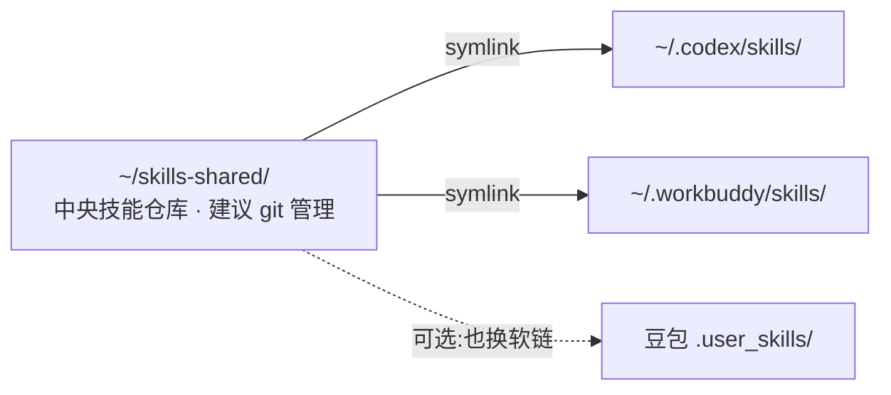

# 技能跨平台迁移方案（豆包办公 → Codex / WorkBuddy）

> 探查日期：2026-10-03
> 现状：Codex CLI 0.154.0、WorkBuddy（com.tencent.workbuddy.mac）均已安装，且两边都已存在 skills 目录。

---

## 一、核心结论（好消息）

**三个工具用的是同一套「Agent Skills」标准**：一个技能 = 一个文件夹，里面是 `SKILL.md`（YAML 前言声明 `name` + `description`）加 `scripts/`、`references/`、`assets/` 等资源。

- 豆包的技能**不需要做任何格式转换**；
- 把技能文件夹放到对应工具的技能目录，重启/下一轮对话即可被**自动发现**（模型根据 description 判断何时调用，也可手动 `/技能名` 唤起）；
- 真正的工作量不在「迁移」，而在「**技能依赖的工具在新工具里是否存在**」（见第四、五节）。

### 三个技能目录对照

| 工具 | 全局技能目录 | 当前内容 |
|---|---|---|
| 豆包办公（自建） | `…/DoubaoWork/…/workspace/.user_skills/` | 17 个（你的沉淀，迁移源头） |
| Codex CLI | `~/.codex/skills/` | 仅有 `.system/` 系统技能（skill-creator 等） |
| WorkBuddy | `~/.workbuddy/skills/` | 已装 5 个：eli5、image-partner、obsidian、前端开发、高品质前端设计 |

另外两处技能库的处置：
- `.skills/`（110 个，豆包内置）：**不建议迁**——平台专属能力，且随豆包版本更新；
- `~/.agents/skills/`（28 个，lark-cli 飞书系列）：是飞书 CLI 的通用技能。**Codex 侧若 `lark-cli` 可用，整套软链过去即拥有飞书操作能力**；WorkBuddy 侧不需要。

---

## 二、推荐架构：中央仓库 + 符号链接（一处维护，三处可用）

不建议在三个工具里各放一份拷贝（以后改技能要改三遍，必然漂移）。建议建一个独立的「中央技能仓库」，各工具目录用**软链接**指向它。



### 操作命令（确认后执行）

```bash
# 1. 建中央仓库
mkdir -p ~/skills-shared
US="/Users/panda/Library/Application Support/DoubaoWork/Default/.doubaowork/agent_mode/workspace/.user_skills"
cp -R "$US"/* ~/skills-shared/
cd ~/skills-shared && git init && git add -A && git commit -m "init: 从豆包迁入17个自建技能"

# 2. 软链到 Codex（A 档 11 个为例；.system 保持不动）
for s in case-polish-to-outline case-to-storyline course-co-creation \
         knowledge-base-health-check knowledge-base-inbox-archive outline-to-transcript \
         scriptsheet-to-pptx storyline-to-outline transcript-to-xianggao \
         wechat-article-to-local xianggao-annotate; do
  ln -s "$HOME/skills-shared/$s" "$HOME/.codex/skills/$s"
done

# 3. 软链到 WorkBuddy（同样方式；若它不跟随软链，改用 UI 上传 zip）
for s in case-polish-to-outline case-to-storyline course-co-creation \
         knowledge-base-health-check knowledge-base-inbox-archive outline-to-transcript \
         scriptsheet-to-pptx storyline-to-outline transcript-to-xianggao \
         wechat-article-to-local xianggao-annotate; do
  ln -s "$HOME/skills-shared/$s" "$HOME/.workbuddy/skills/$s"
done

# 4.（可选）飞书系列技能也给 Codex
for s in ~/.agents/skills/*/; do ln -s "$s" "$HOME/.codex/skills/$(basename "$s")"; done
```

验证：`ls -l ~/.codex/skills/ ~/.workbuddy/skills/` 看到软链指向；分别打开两个工具，让模型列出可用技能。

---

## 三、17 个自建技能迁移分档清单

### A 档 · 可直接迁移（11 个）

纯方法论或本地脚本（Python/标准库），不依赖豆包专属工具：

| 技能 | 形态 | 说明 |
|---|---|---|
| outline-to-transcript | 纯方法论 | 大纲→逐字稿 |
| transcript-to-xianggao | 纯方法论 | 逐字稿→讲香版 |
| xianggao-annotate | 纯方法论 | 香稿三层标注 |
| case-polish-to-outline | 纯方法论 | 案例打磨（追问用户的环节用自然语言即可） |
| case-to-storyline | 纯方法论 | 案例→故事线 |
| storyline-to-outline | 纯方法论 | 故事线融入大纲 |
| course-co-creation | 3 脚本 | 课件共创 |
| knowledge-base-health-check | 1 脚本 | 知识库本地体检 |
| knowledge-base-inbox-archive | 1 脚本 | 收件箱分拣；飞书仅在「手动接收」时可选 |
| scriptsheet-to-pptx | 4 脚本 | python-pptx 本地生成 PPTX |
| wechat-article-to-local | 4 脚本 | 本地抓取/转换（fetch_html 等） |

### B 档 · 需验证或小改造（6 个）

| 技能 | 依赖点 | 验证/改造方式 |
|---|---|---|
| course-doc-to-local | 脚本为主，`mac_computer_use_tool` 仅浏览器兜底 | 主链路可直接用；兜底环节改 curl 或人工 |
| annotate-to-scriptsheet | 输出飞书表格 | 终端需能跑 `lark-cli`（`~/.lark-cli` 已有配置）；或改为只输出本地 MD |
| course-doc-to-feishu | 飞书文档创建 | 需 `lark-cli` 登录态有效 |
| course-images-to-feishu | 飞书 + OCR | 同上，OCR 链路需另验证 |
| bilibili-video-to-local | 转写走飞书妙记（`--run-lark`） | 需 `lark-cli`；或换本地 whisper 转写 |
| xianggao-to-ppt | 链路编排，调度下游技能 | 下游齐备后做一次整条链路联调 |

> B 档关键前提：`lark-cli` 在普通终端可用（目前它在豆包沙箱路径内，`~/.lark-cli` 配置存在）。需要先在 Terminal 里实测 `lark-cli auth` / 一个最小调用。

---

## 四、关键限制：「能被识别」≠「能跑通」

技能正文里点名的工具是豆包专属的，在另两个工具里没有同名能力，这类段落会失效：

| 豆包专属能力 | 举例 | Codex 侧 | WorkBuddy 侧 |
|---|---|---|---|
| 电脑/浏览器 GUI 操作 | `mac_computer_use_tool`、`interaction.*` | 无；改用 shell / AppleScript / 脚本 | 有桌面操作和连接器，需按它的方式改写 |
| 飞书连接器 | 文档/表格/消息读写 | 需 `lark-cli` 或 MCP | 走腾讯文档/连接器体系 |
| 内容生成 | `image_gen`、`image_to_video` 等 | 无内置 | 部分有（image-partner 等） |
| 垂类数据工具 | `seed_finance/medical/legal_search` | 无；需自带 API Key 或 MCP | 技能市场可能有替代 |

**改造原则**：
1. 技能正文尽量只依赖「Python3 + 标准库 + 常见命令行」，这是三个工具的最大公约数；
2. 专属工具不要写死成唯一路径，写成「优先用 X，缺失则用 Y 兜底」；
3. 每个迁移技能至少跑一次真实任务闭环，而不是只看目录里有没有它。

---

## 五、备选导入通道（不用软链时）

- **Codex**：内置 `skill-installer` 技能，支持从 GitHub 仓库安装（公开/私有库均可）。中央仓库推到 GitHub 私有库后，可在 Codex 里直接说「从 <你的仓库> 安装技能」；
- **WorkBuddy**：左侧「技能」面板 → 添加技能 → **上传技能**（拖拽整个技能文件夹打成的 `.zip`）；也可直接把 `SKILL.md` 拖进对话窗口说「导入技能」。

---

## 六、待你确认的决策点

> ✅ **2026-10-03 已确认并执行完毕**：范围＝A档11个；仓库＝`~/skills-shared`；git＝是；双侧（WorkBuddy + Codex）软链。B档6个暂不迁（lark-cli 不在终端 PATH 上，链路跑不通，待验证后再迁）。
>
> **执行记录**：
> 1. 11个技能拷贝至 `~/skills-shared/`，SKILL.md 前言（name+description）全部符合 Agent Skills 标准，无需改格式；
> 2. git 已初始化并提交（`bfece8e`，32 个文件）；
> 3. `~/.workbuddy/skills/` 与 `~/.codex/skills/` 各建 11 个软链，软链解析验证通过；
> 4. 脚本安全扫描通过：仅 wechat-article-to-local 有 8 个本地脚本（4个skill），subprocess 仅用于 curl 抓取，无危险命令；
> 5. 注意：新技能需**下一轮新对话**才会被 WorkBuddy/Codex 自动发现加载，当前会话看不到。

1. **中央仓库位置**：`~/skills-shared/` ？还是你指定的目录（如某个 iCloud / 同步盘目录，顺便多机同步）？
2. **是否 git 管理**：建议是（可回滚、可推私有库、Codex 可直接从 GitHub 装）；
3. **迁移范围**：先迁 A 档 11 个跑通，还是 A+B 共 17 个一次到位（B 档需先测 lark-cli）？
4. **豆包侧原件**：保持现状（双份，仓库为额外副本），还是也把 `.user_skills` 里的目录换成软链，实现真正的「一处维护」？

---

## 七、执行记录（2026-10-03 12:15 完成）

**结果：17/17 全部迁入，双侧（WorkBuddy + Codex）软链解析 17/17 通过。**

- 中央仓库 `~/skills-shared/` git 管理（main 分支），→ 软链至 `~/.workbuddy/skills/` 与 `~/.codex/skills/`
- **B档 6 个已迁入**（lark-cli 误判已纠正）：annotate-to-scriptsheet、course-doc-to-local、course-doc-to-feishu、course-images-to-feishu、bilibili-video-to-local、xianggao-to-ppt
- **lark-cli 状态修正**：一直装着（npm 全局 `~/.npm-global/bin`，v1.0.81），只是不在 agent shell PATH。已双软链修复：
  - `/usr/local/bin/lark-cli` → 供终端 / Codex 登录 shell
  - `~/.workbuddy/binaries/node/cli-connector-packages/bin/lark-cli` → 供 WorkBuddy agent shell
- **登录态**：bot ready；用户身份（周磊）refresh token 已于 2026-08-13 过期 → 跑飞书用户级操作（文档/表格/妙记转写）前需在终端执行 `lark-cli auth login`
- **架构发现**：`.user_skills` 中 6 个技能本是软链，真正维护点是 `~/Desktop/knowledge-base/.skills/`；skills-shared 中这 6 个保持软链指向，改一处三端生效，无需再动
- 决策点落定：仓库 = `~/skills-shared/`；git = 是；范围 = 全部 17 个；豆包侧 = 保持现状
- 新技能需新开对话才会被工具加载；整链路验证待各技能跑一次真实任务
